# STM32_1 인터럽트와 PWM 결과보고서
주윤찬 · 2023440132 · 2026년 10월 19일
제출 태그: stm32-1-results-20261019-v2
소스·증거 커밋: cf68ea5bc775d231aafca292da9399f31893b6d0
저장소: https://github.com/YunchanJu/lab4_stm32_0

## 1. 실험 목적과 구현 방법

### 1.1 목적 및 실험 구성

10월 19일 실습은 버튼 외부 인터럽트, TIM6 주기 인터럽트와 TIM3 PWM을 이용해 폴링 방식의 LED 제어를 확장하는 실험이다. 과제3은 버튼 입력으로 LED 상태 변경 간격을 선택하고, 과제4는 PWM 듀티를 바꾸며 C 디버거와 오실로스코프에서 이를 확인한다.[1]

FPGA 개별 실습은 피아노·신호등·외부 ADC이다. 각 실습의 입력과 출력, 테스트벤치의 검사 항목을 비교하고 실제 보드 시연과 디지털 시뮬레이션이 뒷받침하는 결론의 범위를 구분하였다.[1,2]

| 항목 | 구성 및 관측 |
| --- | --- |
| MCU | NUCLEO-G474RE, STM32 HAL |
| 버튼 / LED | 외부 인터럽트 / 내장 LED PA5 |
| 타이머 | TIM6 100ms 인터럽트 |
| PWM | TIM3 CH1, PB4-GND 계측 |
| 개발 / 계측 | VS Code 디버거, Vivado, Tektronix TBS2000B |

### 1.2 회로와 신호 경로

버튼 입력 → EXTI 콜백 → button_isr_p7()로 처리한다. TIM6 업데이트 → HAL_TIM_PeriodElapsedCallback() → tim6_isr_p4()에서 누적 횟수를 세어 PA5를 토글한다. 두 경로의 상태를 공유하되 메인 루프에서는 버튼·LED 시간을 다시 처리하지 않는다.

PWM은 PB4 출력과 계측기 CH1, 공통 GND를 연결한다. 내장 LED의 PA5와 PWM 출력 PB4는 서로 다른 핀이므로 LED 밝기를 PWM 파형의 대리 지표로 삼지 않았다. 보드 구성은 ST의 UM2505를 참고하였다.[3]

### 1.3 타이머와 PWM 계산

보관된 MCU 설정의 타이머 입력을 100MHz로 두면 업데이트 주기는 (PSC+1)(ARR+1)/fTIM이다. TIM6의 PSC=9999, ARR=999에서 0.1초가 되고, 10번 누적하면 LED 상태 변경 간격 1초가 된다.

| 구분 | 계산값 |
| --- | --- |
| TIM6 | 100MHz /10000 /1000 =10Hz |
| TIM3 PWM | 100MHz /100 /1000 =1kHz |
| PWM 한 주기 | 1ms |
| 듀티 | CCR /(ARR+1) ×100% |

TIM3의 PSC=99, ARR=999에서 CCR=250·500·750은 각각 25·50·75%를 뜻한다. CCR을 바꾸는 것은 비교 시점을 바꾸는 것이며 주기 250·500·750으로 변경하는 것이 아니다.

### 1.4 증거 및 소스의 범위

사용자가 제공한 원본 영상 5개와 사진 19개를 보존했다. 과제3영상.mp4는 과제3, 과제3 오실로.mp4는 과제4이다. 영상 주요 장면은 추출 시각과 함께 저장했다. 정지 사진만으로 시간 변화 전체를 입증하지 않고 원본 영상도 연결했다.

FPGA 사진은 다른 PC에서 실행한 프로젝트의 캡처이다. 당시 원본 소스·XDC·bit는 확보하지 못했다. 저장소의 기존 준비 소스를 복원·재검증했으나 촬영에 사용한 파일과 같다고 단정하지 않는다. 특히 ADC와 신호등에서 관찰되는 차이를 후술한다.

전체 소스와 출처 기록

## 2. 과제3 · 인터럽트 기반 LED 간격 변경

### 2.1 ISR 역할 분리

버튼 ISR은 200ms 이내의 반복 입력을 제거하고 간격을 10→20→40→80→10 tick으로 변경한다. TIM6 ISR은 100ms마다 카운터를 증가시켜 선택된 값에 도달했을 때 LED를 토글한다. 이때의 1·2·4·8초는 LED가 켜짐 또는 꺼짐 상태에서 바뀌는 간격이며 전체 점멸 주기는 그 두 배이다.

/* core logic, abbreviated */
interval_ticks *= 2U;
if (interval_ticks > 80U)
    interval_ticks = 10U;

if (++count >= interval_ticks) {
    count = 0U;
    HAL_GPIO_TogglePin(PORT, PIN);
}

공유 상태는 volatile로 선언한다. volatile은 인터럽트 간 재읽기를 보장하는 용도이며 복합 연산의 원자성을 대신하지 않는다. 준비 소스에서는 버튼 ISR의 간격 변경과 카운터 초기화 구간을 PRIMASK 저장·복원으로 보호한다. TIM6 우선순위 4, 버튼 7 조건을 고려했다.[1]

| 선택값 | 상태 변경 간격 | 전체 점멸 주기 |
| --- | --- | --- |
| 10 tick | 1초 | 2초 |
| 20 tick | 2초 | 4초 |
| 40 tick | 4초 | 8초 |
| 80 tick | 8초 | 16초 |

polling_routine()은 비워 두고 ISR 안에서 printf, 입력 대기, HAL_Delay를 사용하지 않았다. 간격 변경 직후 첫 토글은 TIM6의 현재 위상에 따라 최대 100ms 일찍 나타날 수 있다.

과제3 소스·실제 영상

### 2.2 보드 시연 주요 장면

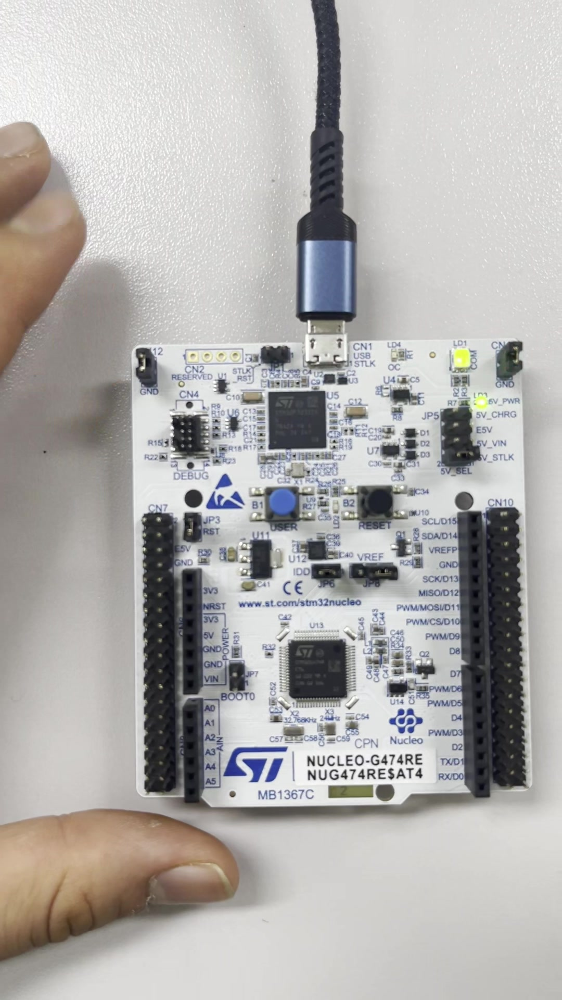

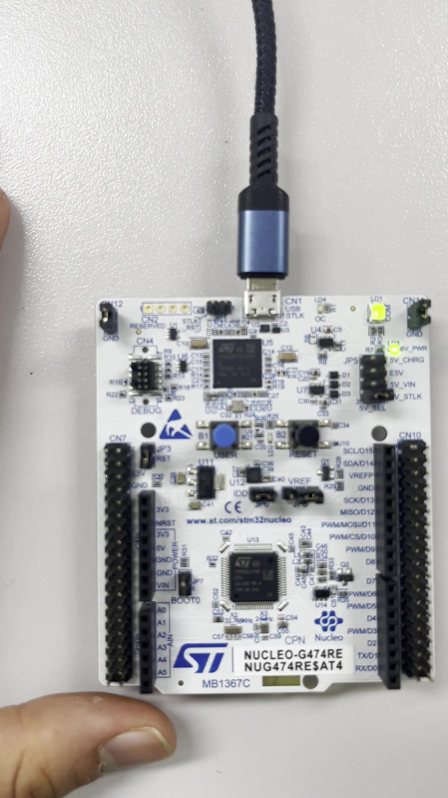

### 2.3 예상과 관측의 비교

시연 영상은 버튼을 이용한 보드 동작 확인 자료로 보관하였다. 다만 영상에서 버튼 유효 입력 시점과 PA5 전환을 프레임 단위로 동기화한 측정표는 제공되지 않았다. 따라서 간격이 정확히 1.000·2.000·4.000·8.000초로 측정되었다고 기재하지 않는다.

재검증에서는 STM32_1_STAGE=4를 포함한 5개 모드의 ARM 빌드를 통과했다. 이는 인터럽트 분기와 HAL 호출이 포함된 프로젝트의 빌드 확인이며 실제 시간 정확도 측정을 대신하지 않는다. 후속 검증은 PA5 파형과 버튼 입력을 동시에 기록해 각 정상 구간의 연속 토글 간격을 비교하는 방식이 적절하다.

## 3. 과제4 · PWM 변경 및 측정 결과

### 3.1 디버거에서 상태 순환 확인

버튼 입력마다 g_pwm_step을 순환시키고 CCR=250×(step+1)을 기록한다. TIM3 CH1 비교값을 갱신하며 주파수 설정은 유지한다. 첨부 Watch 화면의 순서는 250→500→750→250이다.

g_pwm_step=(g_pwm_step+1U)%3U;
g_pwm_ccr=250U*(g_pwm_step+1U);
__HAL_TIM_SET_COMPARE(&htim3,
    TIM_CHANNEL_1,g_pwm_ccr);

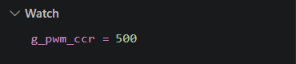

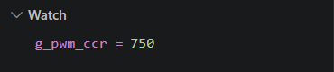

중단점에서 멈춘 시간은 정상 실행 시간 측정에 포함할 수 없다. Watch·F10은 상태 갱신 순서 확인에 사용하고, 파형 측정은 중단점을 해제하여 실행한 계측 화면을 근거로 삼는다.[1]

| 설정 | 실측 듀티 | 오차(%p) |
| --- | --- | --- |
| 25% | 24.79% | -0.21 |
| 50% | 50.34% | +0.34 |
| 75% | 74.98% | -0.02 |

오차는 실측값-설정값의 퍼센트포인트 차이다. 상대 오차율과 구별한다.

### 3.2 오실로스코프 실측

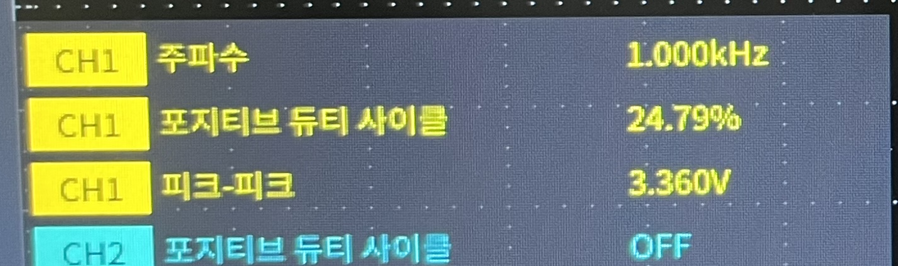

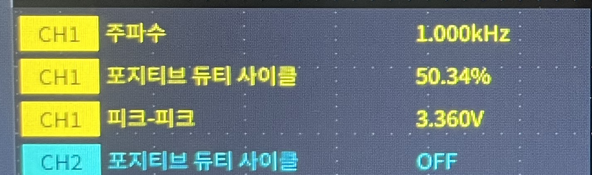

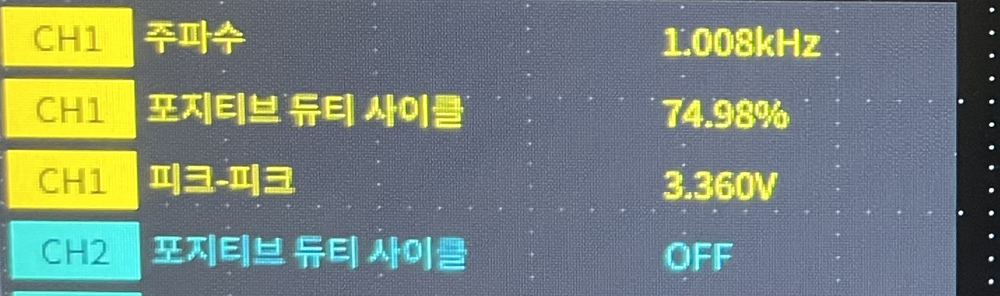

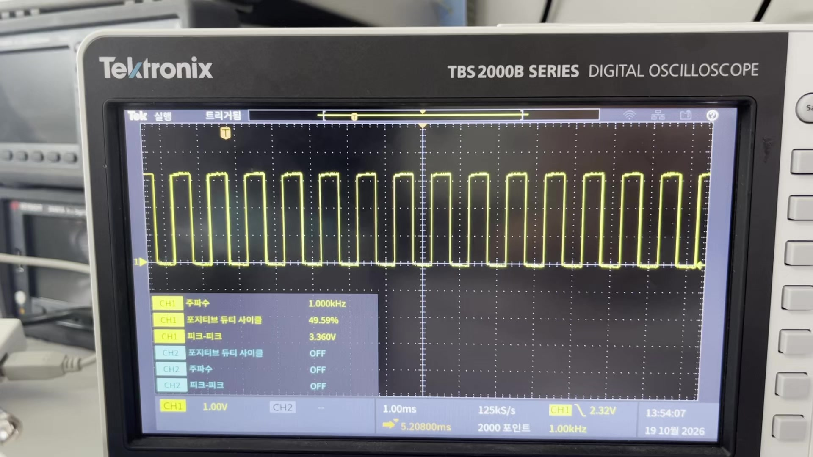

세 사진의 듀티는 설정값에 가깝고 최대 편차는 0.34%p이다. 주파수는 1.000·1.000·1.008kHz로 표시되었다. 마지막 값은 목표 대비 +0.8%이나 계측 분해능·획득 조건·반복 측정 정보가 없어 원인을 MCU 클록 오차로 단정할 수 없다.

표시 주파수와 듀티로 계산한 HIGH 시간은 약 247.90·503.40·743.85µs이다. 이는 사진 표시값에서 유도한 값이며 커서로 직접 측정한 결과가 아니다. 모든 사진에서 3.360Vpp가 표시되었다.

원본 파형·영상 및 측정 CSV

## 4. FPGA 추가1·2 · 피아노와 신호등

### 4.1 피아노: 입력별 음 출력

피아노는 키 입력에 따라 분주값을 선택하여 piezo를 토글하는 구조이다. 테스트는 8개 음과 무입력, 복수 키, 리셋을 포함한다. 첨부 캡처에서 해당 검사에 대한 PASS 메시지와 종료 시각 1476ns를 확인했다. 시뮬레이션의 축약된 CLK_HZ 값은 실제 음의 주파수 측정과 구별한다.[2]

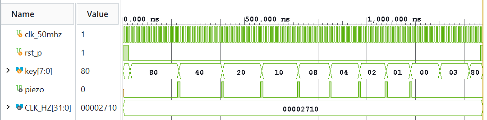

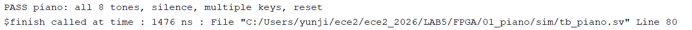

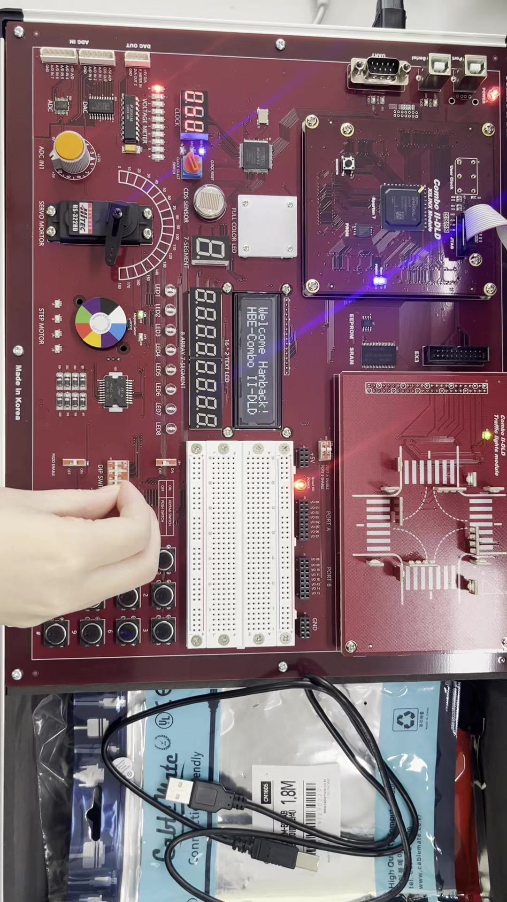

Hardware Device Properties에는 xc7s75_0의 Programmed 상태와 piano.bit 경로가 제시되어 있다. 보드 영상은 15.33초로 원본을 함께 연결했다. 음계별 정확한 Hz를 계측한 표는 없어 청각적 시연과 파형 검사를 중심으로 해석한다.

피아노 RTL·TB·영상·Programmed 화면

### 4.2 신호등: 상태 진행 및 점멸

신호등은 방향과 단계 카운터로 차량 적·황·녹색, 좌회전 및 보행자 신호를 조합한다. 첨부 파형에는 방향 진행과 보행자 녹색 점멸, flicker 전환이 나타나며 전체 주기·보행자 점멸·flicker·리셋 PASS가 2200ns에 표시되었다.

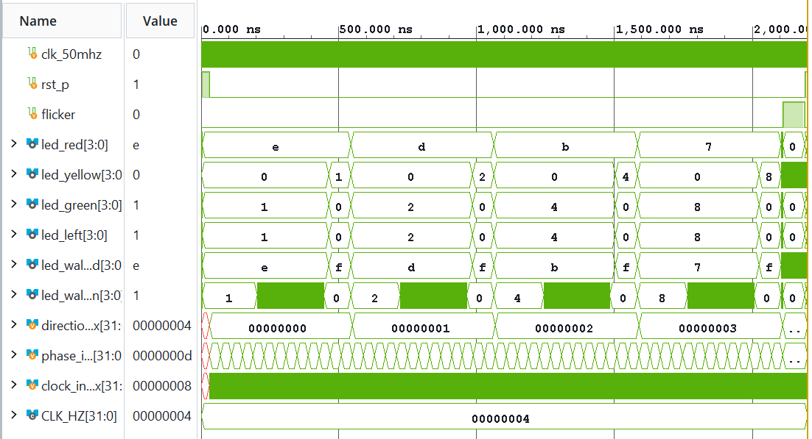

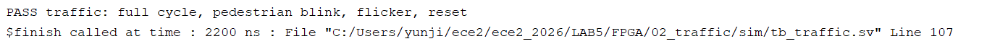

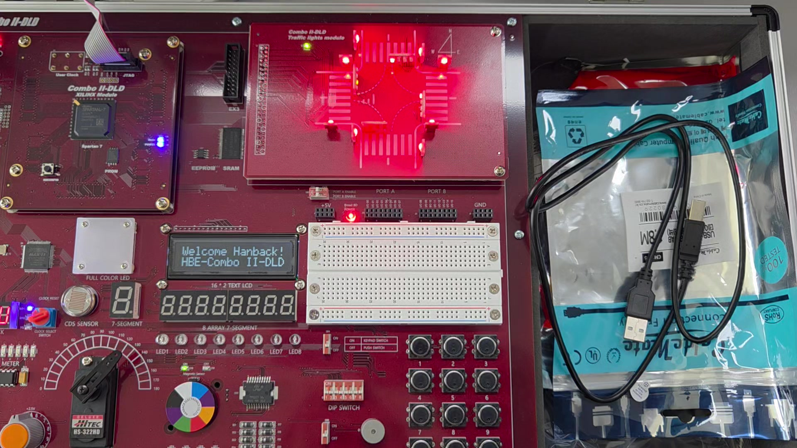

첨부 파형의 녹색 비트 순서는 1→2→4→8인 반면 보관된 준비 코드의 방향 매핑은 8→4→2→1이다. 동일한 실행 소스라고 보기 어려워 두 자료를 구별하였다. 당시 Programmed 화면의 traffic.bit도 현재 저장소에 해당 원본이 없으므로 새 bit로 대체하지 않았다.

71.72초 원본 영상을 보존했으며 상태별 시간을 정량 추출한 기록은 없다. 준비 코드의 52초 시퀀스가 그대로 실측되었다는 결론은 내리지 않는다.

신호등 RTL·TB·실제 시연

## 5. FPGA 추가3 · 외부 ADC

### 5.1 직렬 변환 인터페이스

이번 ADC 실습은 FPGA가 외부 변환 장치를 제어하는 실습이다. STM32 내부 ADC 실험과 구별한다. FPGA는 칩 선택과 직렬 클록, 채널 제어 비트를 출력하고 ADC 데이터를 시프트하여 sample과 유효 신호를 만든다.[1,2]

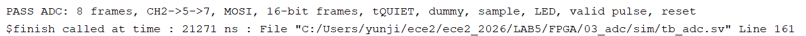

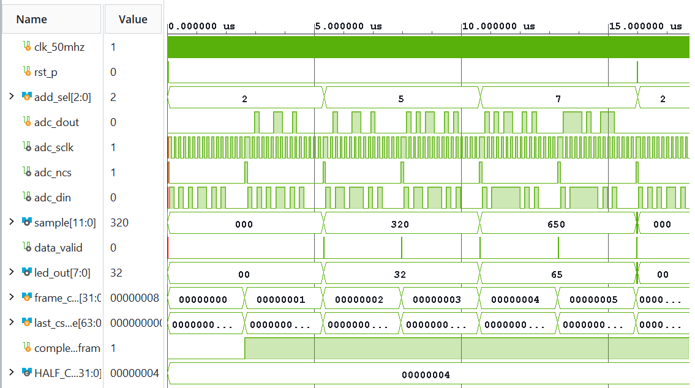

캡처 메시지는 CH2→5→7, MOSI, 16비트 프레임, tQUIET, dummy, sample, LED, valid pulse 및 리셋을 검사했다고 명시한다. 파형에는 sample=0x320과 0x650, 이에 대응하는 led_out=0x32와 0x65가 나타난다. 각각의 표본값은 10진수 800과 1616이다.

| 시뮬레이션 표본 | 10진수 | LED 표시 |
| --- | --- | --- |
| 0x320 | 800 | 0x32 |
| 0x650 | 1616 | 0x65 |

위 수치는 디지털 장치 모델이 제공한 시뮬레이션 값이다. 실제 아날로그 입력 전압을 계측해 얻은 값으로 사용하지 않았다.

### 5.2 실제 시연과 재현 범위

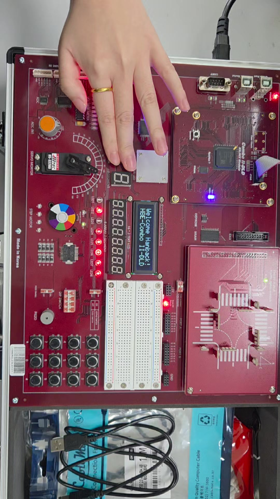

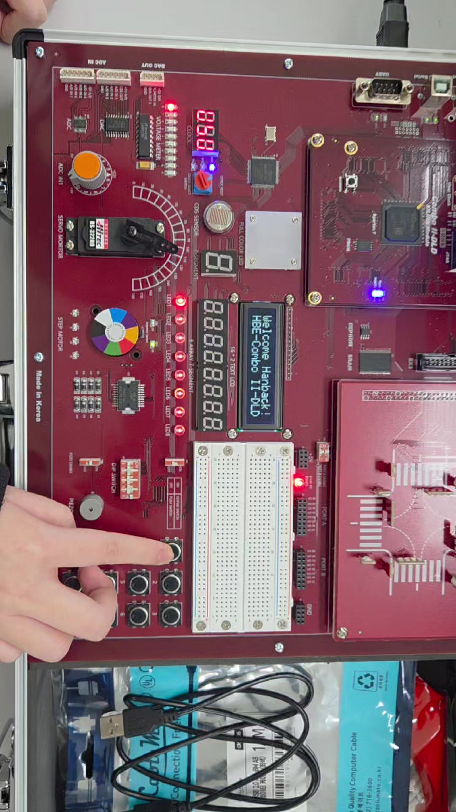

실제 보드 시연 원본 16.40초를 보관했다. 그러나 ADC 장치 모델명, 기준 전압 Vref, 입력 전압과 출력 코드의 동시 기록이 없다. 따라서 전압 환산 정확도·선형성·분해능 오차에 대한 정량 결론은 유보한다.

촬영 캡처의 TB는 8프레임·다채널 검사이고 준비본 TB는 3프레임 검사이다. 이번 재검증에서 준비본의 PASS를 확인했지만 이를 첨부 캡처의 원본 TB 복원으로 주장하지 않았다. 물리 핀을 확인할 수 없는 XDC는 clock_only 상태로 남겨 실제 장치 연결을 임의로 확정하지 않았다.

ADC 준비 소스·원본 증거

## 6. 고찰·결론 및 제출 자료

### 6.1 비교와 문제 해결

| 항목 | 확인된 결과 | 남은 검증 |
| --- | --- | --- |
| 과제3 | 원본 시연·ISR 준비 코드 | 1/2/4/8초 동시 계측 |
| 과제4 | CCR 순환·듀티 3종 실측 | 반복 측정·주파수 오차 원인 |
| 피아노 | 8키 TB PASS·보드 시연 | 음계별 주파수 계측 |
| 신호등 | 상태·점멸 TB·보드 시연 | 촬영 소스와 핀 매핑 |
| ADC | 프레임 TB·보드 시연 | 모델/Vref·전압-코드 표 |

자료 정리 과정에서 영상 이름과 과제 번호가 어긋난 부분을 사용자 확인에 따라 수정했다. CCR 값을 주기로 표현하던 혼동은 비교값과 듀티의 관계로 정리했다. 디버거 정지 상태와 정상 실행 중 시간 측정도 분리했다.

전체 ZIP 안에 있던 MCU Core·Drivers·CMake·IOC·시작 코드·링커 스크립트를 펼쳐 프로젝트를 복원했다. 재검증은 STM32_0 네 모드, STM32_1 다섯 모드, STM32_2 세 모드의 ARM 빌드와 FPGA TB 9개를 포함한다. 이는 재현을 위한 준비 검증이며 과거 촬영 소스의 동일성을 증명하지 않는다.

### 6.2 결론

PWM은 목표 25·50·75%에 대해 최대 0.34%p의 듀티 편차를 보였고, 비교값을 변경하여 듀티를 제어하는 동작을 디버거와 계측 화면에서 함께 확인했다. ISR 기반 LED와 FPGA 실습은 원본 시연·파형을 연결해 동작을 검토했으며 자료가 없는 정량값은 결론에서 제외했다.

### 6.3 제출 버전과 자료 경로

https://github.com/YunchanJu/lab4_stm32_0

제출 태그: stm32-1-results-20261019-v2소스·증거 기준 커밋:cf68ea5bc775d231aafca292da9399f31893b6d0

보고서가 인용한 코드·원본 증거는 위 커밋에 고정되어 있다. 최종 PDF를 포함한 제출 상태는 해당 태그에서 확인한다. 모든 영상은 각 실험 evidence 폴더에서 내려받아 재생할 수 있다.

과제3 영상 · 과제4 영상

피아노 영상 · 신호등 영상 · ADC 영상

제출 현황표 · 검증 요약 · 원본 분류 및 해시

### 참고문헌

[1] thechef030, 「STM32_1 · 인터럽트와 PWM」, 4주 실습 매뉴얼. 2026-10-26 확인. 버튼·타이머·PWM 요구사항을 요약·참고하였다.교안 STM32_1 원문

[2] thechef030, 「FPGA 모듈별 Verilog 소스와 테스트벤치」, FPGA_additional.md. 피아노·신호등·ADC 구조와 테스트 항목 참고. 2026-10-26 확인.FPGA 교안 원문

[3] STMicroelectronics, STM32G4 Nucleo-64 boards (MB1367), User manual UM2505. 보드 개요와 연결 구성 참고.ST 공식 사용자 매뉴얼

그림 1~20: 사용자 제공 10/19 사진 및 영상에서 발췌. 직접 인용한 코드 조각은 제출 준비 소스를 축약한 것으로 전체 파일을 함께 연결했다. 타 PC의 촬영 소스와 동일함을 뜻하지 않는다.
