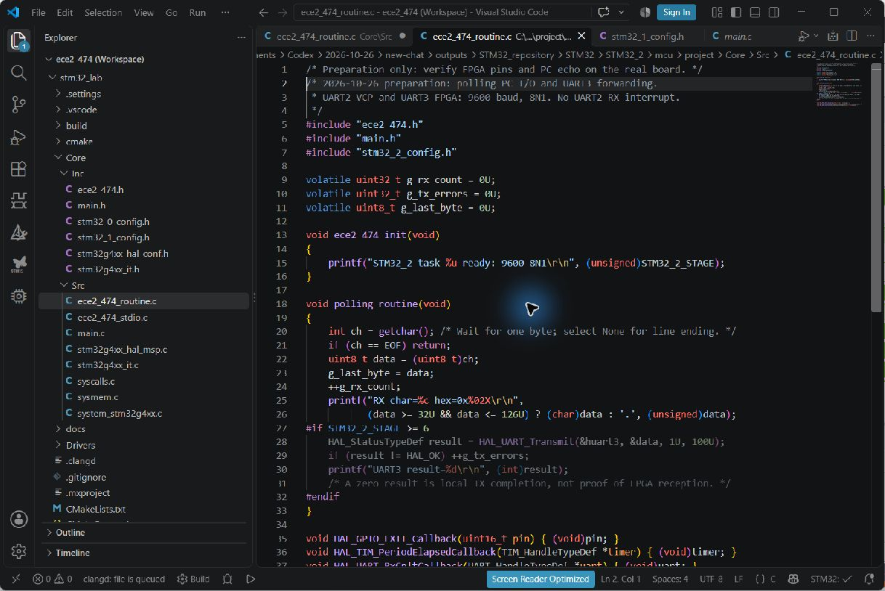
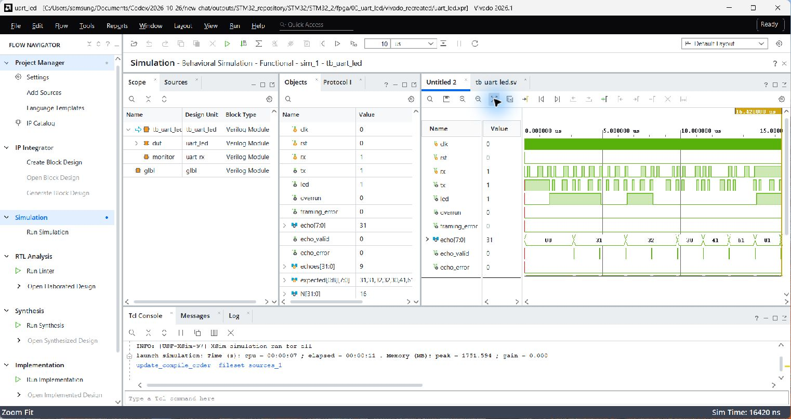
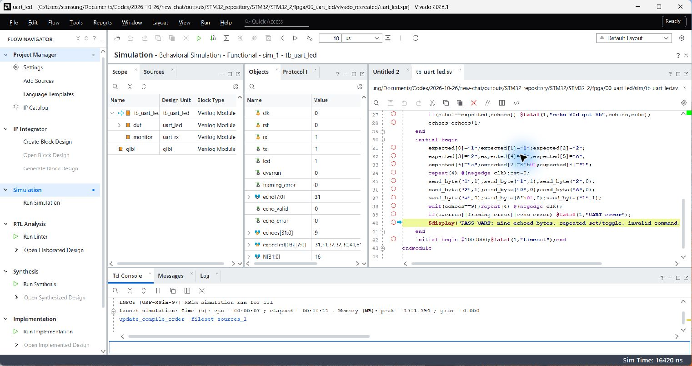
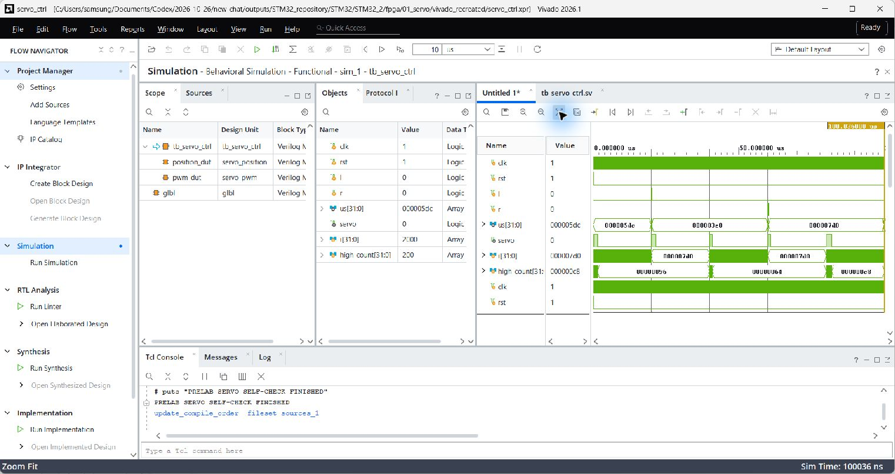
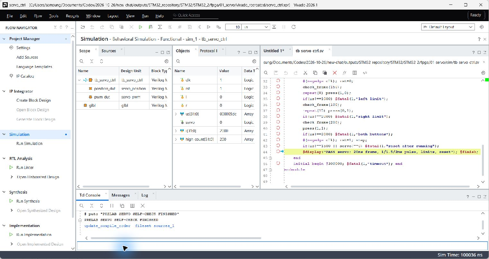
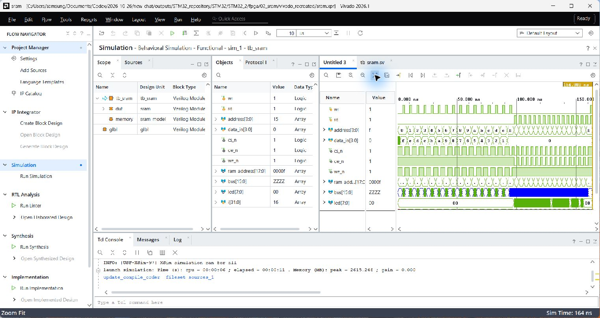
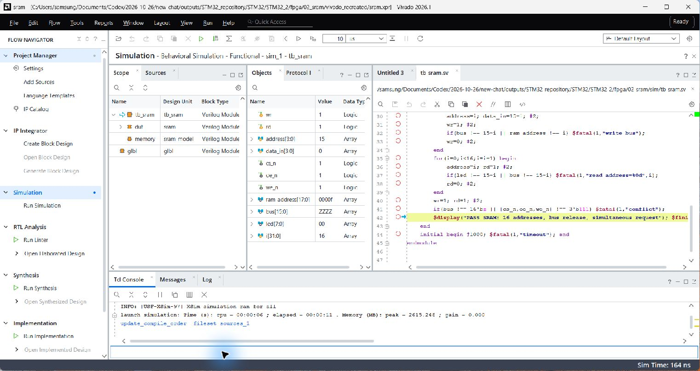
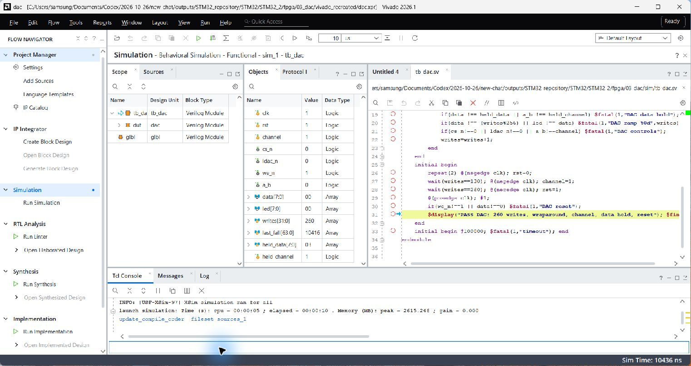
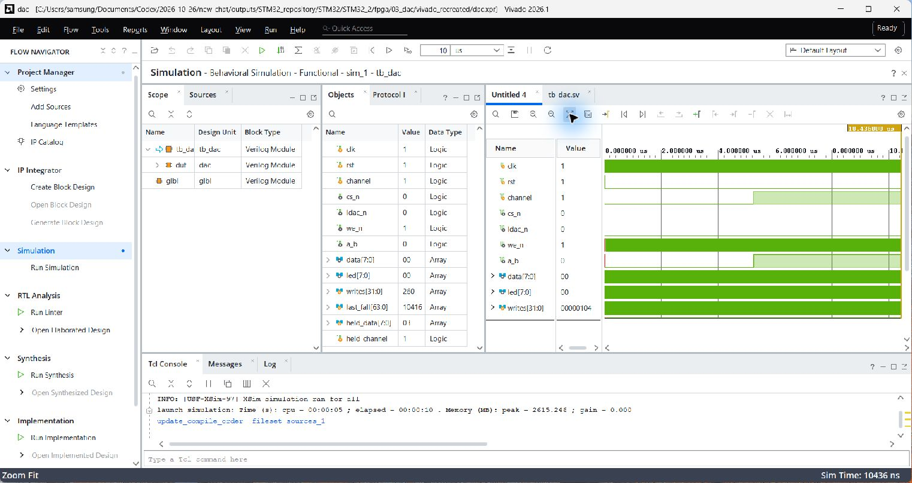

# STM32_2 컴퓨터와 FPGA 통신 예비보고서
주윤찬 · 2023440132 · 2026년 10월 26일
제출 태그: stm32-2-prelab-20261026-v1
소스·증거 커밋: cf68ea5bc775d231aafca292da9399f31893b6d0
저장소: https://github.com/YunchanJu/lab4_stm32_0

## 1. 실험 목표와 MCU 준비

### 1.1 단계별 목표

10월 26일 실습은 PC의 문자 입력을 STM32에서 수신한 뒤 FPGA까지 전달하고, 명령에 따라 FPGA LED를 제어하는 과정이다. 과제5→6→7 순서로 한 단계의 입력·출력을 확인한 후 다음 단계를 수행한다. FPGA 개별 실습은 서보모터, SRAM, DAC 순서이다.[1]

| 과제 | 데이터 흐름 | 기대 결과 |
| --- | --- | --- |
| 5 | PC→MCU→PC | 문자와 16진수 일치 |
| 6 | PC→MCU→FPGA→PC | 수신 바이트 동일 |
| 7 | PC→MCU→FPGA | 0/1/2 명령 LED 제어 |

### 1.2 통신 조건과 예상 시간

Serial Monitor와 MCU UART2·UART3, FPGA UART를 9600 baud, 8비트, 패리티 없음, 정지 비트 1(8N1)로 맞춘다. 한 문자를 보낼 때 줄바꿈은 None이다. 입력이 없으면 getchar()가 대기하는 것이 정상이다.[1]

한 비트는 1/9600=104.167µs이며 시작 1+데이터 8+정지 1의 10비트 전송은 약 1.04167ms이다. PC→MCU→FPGA에는 수신·전달·송신 처리 시간이 더해지므로 이를 단일 비트 시간과 혼동하지 않는다.

| 입력 문자 | 바이트 값 |
| --- | --- |
| '1' | 0x31 |
| 'A' | 0x41 |
| 'a' | 0x61 |
| 숫자 1 | 0x01: 문자와 다름 |

NUCLEO-G474RE의 ST-LINK/VCP 연결은 보드 사용자 매뉴얼 UM2505와 교안에 따라 확인한다.[1,3]

### 1.3 작성한 C 코드

int ch = getchar();
if (ch == EOF) return;
uint8_t data = (uint8_t)ch;
int printable=(data>=32U&&data= 6
HAL_StatusTypeDef result =
  HAL_UART_Transmit(&huart3,
                   &data,1U,100U);
#endif

EOF를 표현하기 위해 getchar 결과를 int로 받고, 정상 입력만 uint8_t로 변환한다. 출력 시 비인쇄 문자는 점으로 표시하되 16진수는 원래 바이트를 유지한다. UART2 인터럽트 수신과 getchar를 동시에 사용하지 않는다.

STM32_2_STAGE=5·6·7을 각각 선택할 수 있는 전체 CMake 프로젝트를 준비했다. 세 모드 모두 ARM 빌드를 통과했다. g_rx_count·g_last_byte·g_tx_errors를 디버거에서 관찰할 수 있으며 실제 COM 포트 입출력은 실험에서 추가 확인한다.

전체 MCU 프로젝트·빌드 안내

## 2. 과제6·7 · UART 전달과 FPGA 명령 처리

### 2.1 배선과 FPGA 핀 설정

MCU PC10(TX)을 FPGA 확장 GPIO RX에, 양쪽 GND를 공통으로 연결한다. FPGA TX는 기존 F6의 USB-UART 출력 경로를 유지하여 PC에서 FPGA 수신값을 확인한다. MCU와 FPGA의 COM 포트 두 개를 각각 열어 비교한다.[1]

| 신호 | 연결·설정 |
| --- | --- |
| MCU→FPGA | PC10 TX → 확장 GPIO RX |
| FPGA→PC | F6 TX → 보드 USB-UART |
| 공통 접지 | MCU GND ↔ FPGA GND |
| MCU 응답(선택) | 별도 FPGA TX → PC11 RX |
| FPGA XDC | 확장 GPIO의 실제 PACKAGE_PIN 확인 |

기존 FPGA USB-UART RX C6는 MCU 점퍼선 입력과 다른 경로이다. XDC에는 MCU의 PC10이 아닌 실제 FPGA 칩 패키지 핀을 지정한다. 현재 확장 커넥터 핀맵이 없으므로 임의 핀을 넣어 bit를 만들지 않았다. MCU 핀은 제공된 IOC/C 설정을 사용한다.[1]

### 2.2 UART RTL 구성

새 수신 회로는 비동기 입력을 2단 플립플롭으로 동기화하고 시작 비트 중심에서 재확인한다. 이후 8비트를 LSB부터 표본화하고 정지 비트가 HIGH인지 확인하여 data_valid를 한 클록 발생시킨다. 수신 바이트는 UART 송신기로 에코하고 LED 명령 처리에 함께 전달한다.

1바이트 대기 버퍼와 overrun·framing_error 상태를 두었다. 이번 구현은 실습용 단일 스트림이다. 지속적인 고속 입력이나 장시간 PC 출력 정체는 별도 FIFO·흐름 제어가 필요한 조건이다.

UART RX/TX·LED RTL과 TB

### 2.3 명령 및 자체 검사

| 문자 | LED 동작 | 반복 입력 기대 |
| --- | --- | --- |
| 0 | 끄기 | 계속 꺼짐 |
| 1 | 켜기 | 계속 켜짐 |
| 2 | 반전 | 매번 바뀜 |
| 기타 | 유지 | 현재 상태 유지 |

TB는 문자 1 반복, 2 반복, 0, A, a, 숫자 0x01 및 최종 1을 전송하여 에코와 LED 결과를 검사했다. Vivado에서 9개의 에코와 오류 신호 0을 확인했다. 시뮬레이션은 시간을 줄인 분주 파라미터로 수행하며 파형 축의 µs를 실제 9600 baud의 실측 시간으로 해석하지 않는다.

MCU HAL 결과 0은 MCU 송신 함수의 정상 종료를 뜻한다. FPGA 수신 성공은 FPGA USB-UART 출력과 실제 LED로 따로 확인한다. 최종 시연은 1/A/a 바이트 비교와 0/1/2 반복 명령을 포함한다.

## 3. FPGA 서보모터 제어

### 3.1 구조와 설계값

교안의 servo_position, servo_pwm, servo_ctrl 기능별 모듈을 프로젝트로 구성했다.[2] 위치 모듈은 초기 펄스 폭 1500µs에서 좌·우 입력에 따라 100µs씩 변경하고 1000~2000µs 범위로 제한한다. PWM은 20ms 프레임을 유지하며 새 폭을 프레임 경계에서 적용한다.

| 항목 | 예상값(50MHz) |
| --- | --- |
| 클록 주기 | 20ns |
| 프레임 | 1,000,000클록 =20ms |
| 1000µs HIGH | 50,000클록, 5% |
| 1500µs HIGH | 75,000클록, 7.5% |
| 2000µs HIGH | 100,000클록, 10% |

FRAME_CYCLES = CLK_HZ/50;
if (frame_end)
  width_cycles <=
    pulse_us*(CLK_HZ/1000)/1000;
assign servo = !rst_p &&
               count<width_cycles;

버튼 입력은 모터 구동 핀에 직접 연결하지 않고 동기화·디바운스 후 한 클록 펄스로 전달해야 한다. 현재 핵심 모듈의 left_pulse/right_pulse 포트는 정제된 입력을 전제로 한다. 외부 모터 전원과 접지, 신호 레벨은 사용 장비 교재의 연결도를 확인한다.

### 3.2 실험 절차

초기 1500µs를 계측한 다음 좌측 반복 입력으로 1000µs, 우측 반복으로 2000µs까지 확인한다. 양쪽 동시 입력은 위치를 유지하고 리셋은 초기값으로 돌아와야 한다. 파형을 먼저 확인한 후 모터의 방향·이동을 영상으로 기록한다. 펄스 폭과 실제 각도의 대응은 사용 모터에서 측정한다.

### 3.3 사전 시뮬레이션

TB의 CLK_HZ는 100000으로 축소하고 프레임 2000클록에서 HIGH 횟수 150·100·200을 각각 검사했다. 이는 20ms 프레임과 1.5·1·2ms 펄스의 비율에 대응한다. 테스트 클록 자체도 빠르게 설정되므로 화면 시간축은 실기 계측값이 아니다.

검사 과정에서는 폭을 변경한 프레임이 끝나기 전에 값을 세지 않도록 새 프레임 시작에서 전체 길이를 세었다. 모든 자체 검사를 통과했다. 실제 각도·전원 안정성·기계적 제한과 장치별 허용 펄스 범위는 이 디지털 TB로 검증되지 않는다.

서보 소스·TB·실행 Tcl·검증 로그

## 4. FPGA SRAM 읽기·쓰기

### 4.1 양방향 버스의 제어

SRAM 실습은 주소에 데이터를 기록한 뒤 같은 주소를 읽어 일치 여부를 확인한다. 교안의 SRAM 제어 모듈과 디지털 메모리 모델 TB를 구성했다.[1,2] 쓰기 때는 FPGA가 data bus를 구동하고 읽기 때는 FPGA가 버스를 Z로 해제하여 외부 메모리가 구동하도록 한다.

| 상태 | 버스 구동 | 제어의 의미 |
| --- | --- | --- |
| 쓰기 | FPGA 출력 | CS 활성, WE 활성, OE 비활성 |
| 읽기 | FPGA Z | CS·OE 활성, WE 비활성 |
| 유휴 | Z | 장치 비선택 |
| 동시 요청 | Z | 충돌 방지, 비활성 |

n 접미사의 CS_n·OE_n·WE_n은 LOW 활성이다. 출력 허용과 쓰기 요청을 동시에 활성화하면 양쪽이 버스를 구동할 수 있으므로 허용하지 않는다. 주소·데이터 setup/hold 시간은 실제 SRAM 데이터시트의 요구값에 맞춰야 한다.

### 4.2 검사 입력과 예상값

주소 0~15에 15-address 패턴을 기록하고 모든 주소를 다시 읽는 TB를 준비했다. 주소 0은 15, 주소 1은 14, 주소 15는 0이 기대된다. 주소별 값이 달라 주소 연결 오류와 단순 동일 값 쓰기의 혼동을 줄인다.

| 주소 | 쓰기값 | 읽기 기대 |
| --- | --- | --- |
| 0 | 0xF | 0xF |
| 1 | 0xE | 0xE |
| 8 | 0x7 | 0x7 |
| 15 | 0x0 | 0x0 |

실기에서는 주소/데이터 비트 폭과 커넥터 핀을 교재로 확인한다. 여러 주소를 기록한 후 읽고 쓰기 신호와 버스의 방향 전환을 파형·영상으로 함께 남긴다. 결과가 다르면 주소 오류와 데이터 오류를 분리하여 점검한다.

### 4.3 사전 검증 결과

실제 Vivado XSim에서 16개 주소의 쓰기·읽기 비교, 유휴 시 Z 상태, 동시 요청 시 제어 비활성을 모두 통과했다. 이때 사용한 메모리 모델은 기능 검사 모델이며 실제 외부 장치의 접근 지연·출력 해제 지연·전압 특성을 모두 재현하지 않는다.

이후 실험에서 데이터가 고정되면 OE/WE 극성과 버스 Z 전환을 우선 확인한다. 특정 주소만 틀리면 주소선과 장치 선택을 확인한다. 현재 핀맵이 확정되지 않아 다운로드용 bit는 생성하지 않았으며, 통과 결과는 준비 RTL·TB의 동작 범위로 한정한다.

SRAM 소스·TB·Vivado 결과

## 5. FPGA DAC 제어

### 5.1 디지털 코드와 아날로그 출력

DAC 실습은 FPGA가 외부 DAC에 코드를 전달하여 아날로그 출력을 만드는 실습이며 STM32 내부 DAC를 사용하는 것이 아니다.[1] 교안의 병렬 DAC 제어 모듈을 구성하여 8비트 램프 데이터와 CS_n·LDAC_n·WE_n, 채널 선택 A/B를 출력한다.[2]

전송된 코드 N에 대한 이상 출력 관계는 장치의 전달 특성에 의존한다. 일반적인 단극성 8비트 DAC는 N/256에 비례하는 형식이 쓰이지만, 실제 출력 범위와 기준 전압·증폭 조건은 사용할 장치 데이터시트에서 확인해야 한다. 장치 모델과 Vref 없이 특정 전압을 실측값으로 기입하지 않는다.

| 코드 | 확인 목적 |
| --- | --- |
| 0x00 | 영점 부근 |
| 0x40 | 하위 중간 구간 |
| 0x80 | 중간 코드 |
| 0xC0 | 상위 중간 구간 |
| 0xFF→0x00 | 최대 코드 및 랩어라운드 |

### 5.2 타이밍과 검사 항목

데이터와 채널은 쓰기 펄스 동안 안정되어야 한다. TB는 UPDATE_CYCLES=4로 빠르게 실행하여 260번의 쓰기, 255→0 랩어라운드, 중간 채널 변경, 데이터 유지 및 리셋을 확인한다. 실제 장치에 연결할 때는 제어 신호 극성과 최소 펄스 폭·setup/hold를 데이터시트에 맞춰 검토한다.

실기에서는 코드별 출력 전압을 측정하여 예상 전압과의 차이, 단조 증가, 램프의 주기 및 되돌아가는 구간을 기록한다. 채널 전환 전후에 출력 단자를 혼동하지 않고 GND 기준으로 계측한다.

### 5.3 실제 Vivado 사전 검사

실제 Vivado GUI XSim에서 자체 검사를 통과했다. TB는 쓰기 펄스 구간에서 데이터와 채널이 변하지 않는지 확인한다. 디지털 코드가 증가하는 결과는 확인했지만 아날로그 전압·출력 settling·부하 효과는 모델에 포함하지 않았다.

코드가 맞는데 전압이 다르면 Vref, 출력 범위 설정, 채널 선택과 출력 부하를 먼저 확인한다. 데이터가 간헐적으로 틀리면 쓰기 에지와 데이터 유지 시간을 확인한다. 이 단계의 화면은 사전 준비 결과이며 실제 DAC 보드 시연 사진으로 사용하지 않는다.

DAC 소스·TB·검증 로그

## 6. 실행 계획·예상 결과 및 참고문헌

### 6.1 준비 상태 및 현장 확인

| 항목 | 사전 확인 | 실험에서 추가할 자료 |
| --- | --- | --- |
| MCU5~7 | ARM 빌드 3/3 PASS | COM 문자·바이트 화면 |
| UART FPGA | 9바이트 XSim PASS | 핀 확정·에코·LED 영상 |
| 서보 | 폭·제한 XSim PASS | 펄스·위치 변화 시연 |
| SRAM | 16주소 XSim PASS | 외부 장치 읽기·쓰기 |
| DAC | 260쓰기 XSim PASS | 전압-코드 표·파형 |

실험 순서는 과제5 단독 VCP 확인 → 과제6 PC10 전달 및 FPGA COM 비교 → 과제7 반복 명령 LED 제어 → 서보 → SRAM → DAC이다. 각 단계의 소스 설정과 실제 배선이 일치하는지 확인하고 실행 화면을 남긴다.

### 6.2 오류 구분과 조치

입력 대기는 getchar의 정상 상태일 수 있다. 문자가 깨지면 양쪽 baud·8N1·COM 포트를 확인한다. MCU 결과 0인데 FPGA 출력이 없으면 공통 GND, PC10 연결, FPGA RX XDC가 C6에 남아 있는지를 확인한다. 명령이 한 번에 여러 개 처리되면 Serial Monitor 줄바꿈 None과 입력 바이트를 확인한다.

디지털 시뮬레이션이 통과해도 외부 핀·장치 전압·아날로그 정확도는 별도 검증해야 한다. 현재 준비본에는 출처, 실행 Tcl과 TB, 실제 개발 화면·검증 로그를 연결했으며 실험 후 같은 폴더에 원본 영상·측정표를 추가할 계획이다.

### 6.3 예상 결론

예상 결과는 문자의 전 구간 일치, 명령별 LED의 안정적 갱신, 서보 펄스 폭 제한, SRAM 주소별 일치, DAC 코드 증가에 따른 출력 변화이다. 실제 보드 결과와의 비교 및 오차 분석은 측정 후 결과보고서에 작성한다.

### 6.4 제출 버전 및 재현 자료

https://github.com/YunchanJu/lab4_stm32_0

제출 태그: stm32-2-prelab-20261026-v1소스·검증 기준 커밋:cf68ea5bc775d231aafca292da9399f31893b6d0

MCU 전체 프로젝트 · FPGA UART

서보 · SRAM · DAC

실제 VS Code·Vivado 화면 · 검증 요약

소스·증거는 위 커밋에 고정하고 최종 PDF를 포함한 제출 상태는 태그로 식별한다. MCU 과제5~7과 UART/LED RTL은 이번 준비에서 작성하였다. 서보·SRAM·DAC는 교안 제공 모듈·TB를 프로젝트로 구성하고 출처를 명시했다. 구현 방법과 검사 범위는 사전 준비 수준이다.

### 참고문헌

[1] thechef030, 「STM32_2 · 컴퓨터와 FPGA 통신」, 4주 실습 매뉴얼. 2026-10-26 확인. 과제5~7·연결 및 개별 실습 요구사항을 요약·참고하였다.STM32_2 교안 원문

[2] thechef030, 「FPGA 모듈별 Verilog 소스와 테스트벤치」, FPGA_additional.md. 서보·SRAM·DAC 기능별 모듈 및 TB 참고·사용. 2026-10-26 확인.FPGA 소스 교안 원문

[3] STMicroelectronics, STM32G4 Nucleo-64 boards (MB1367), User manual UM2505. 보드 및 ST-LINK/VCP 구성 참고.ST 공식 사용자 매뉴얼

그림 1~9: 2026-10-26 이 PC의 실제 VS Code·Vivado 화면. 시뮬레이션 입력과 기대값은 준비 코드의 검증용이며 실물 장비에서 계측한 값이 아니다.
